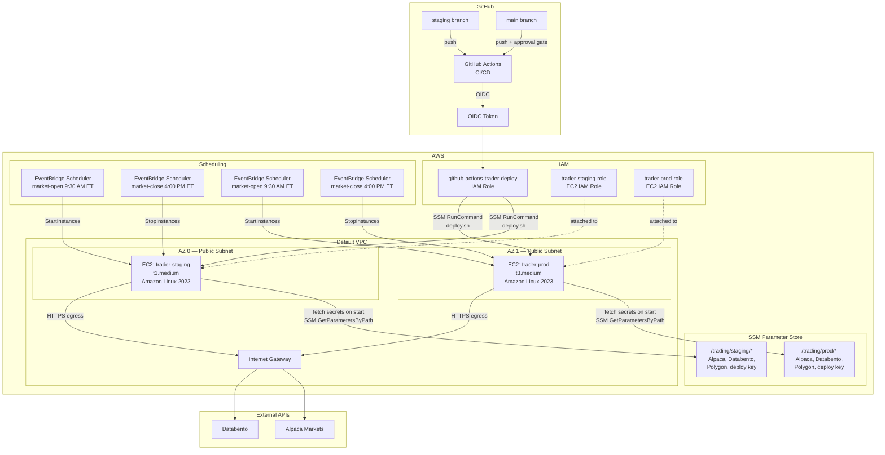

# Infrastructure

OpenTofu configuration for the Qi trading system. Provisions two isolated environments (staging, prod) in AWS using the default VPC, with EventBridge Scheduler for automated market-hours start/stop and SSM for secrets and remote access.

## Why this design

Every choice here exists to keep **credentials out of the repo** and **instances
self-describing**. Secrets never touch disk in VCS — they live in **SSM Parameter
Store**, fetched at instance start via an instance role (no SSH, no checked-in
keys). Deploys go GitHub Actions → **OIDC** role (no stored deploy token)
→ `SSM RunCommand`. Instances are started/stopped by **EventBridge on market
hours** so the trading host only exists (and costs) when markets are open, and
boots from zero config via `user_data` (`scripts/bootstrap.sh`). The result: a
fresh clone plus a push is all it takes to stand up a provably-clean
environment — no secret bootstrap step a human can get wrong.

## Architecture



## What gets provisioned

| Resource | Staging | Prod |
|---|---|---|
| EC2 instance | `t3.medium` | `t3.medium` |
| AMI | Latest AL2023 x86_64 (auto) | Same |
| Subnet | Default VPC, AZ 0 (public) | Default VPC, AZ 1 (public) |
| Security Group | SSH from `my_ip` only + HTTPS egress | Same |
| IAM Role | `trader-staging-role` | `trader-prod-role` |
| EventBridge start | 9:25 AM ET, Mon–Fri | 9:25 AM ET, Mon–Fri |
| EventBridge stop | 4:05 PM ET, Mon–Fri | 4:05 PM ET, Mon–Fri |
| SSM secrets path | `/trading/staging/*` | `/trading/prod/*` |
| Git branch | `staging` | `main` |

**Shared across both environments:**
- GitHub Actions IAM role (`github-actions-trader-deploy`) — OIDC, no stored keys
- SSM Parameter Store secret scaffolding (paths created by Tofu, values set manually)
- Latest AL2023 AMI resolved automatically at apply time

## Prerequisites

Install OpenTofu and the AWS CLI, then authenticate:

```bash
brew install opentofu awscli
aws configure   # or export AWS_PROFILE=...
```

Register the GitHub OIDC provider in your AWS account (one-time, per account):

```bash
aws iam create-open-id-connect-provider \
  --url https://token.actions.githubusercontent.com \
  --client-id-list sts.amazonaws.com \
  --thumbprint-list 6938fd4d98bab03faadb97b34396831e3780aea1
```

The provider is read via a `data` source in `staging/main.tf` (not managed by
OpenTofu) — thumbprints are left as created.

### Immutable subject claims (important)

Repos renamed after July 15, 2026 emit **immutable** OIDC `sub` claims that
embed owner and repo IDs
([changelog 2026-04-23](https://github.blog/changelog/2026-04-23-immutable-subject-claims-for-github-actions-oidc-tokens/)):

```text
repo:<owner>/<repo>@<repo-id>:environment:staging
```

The trust policy's `sub` condition must therefore use the **IDs**, not the
mutable name:

```hcl
condition {
  test     = "StringLike"
  variable = "token.actions.githubusercontent.com:sub"
  values   = ["repo:<owner>/<repo>@<repo-id>:*"]
}
```

Get your IDs with:

```bash
gh api repos/<owner>/<repo> --jq '{owner_id: .owner.id, repo_id: .id}'
```

> Prod does not manage the provider — it reads the shared role. Apply staging first.

## Init

```bash
# Staging
cd infrastructure/staging && tofu init

# Prod (when ready)
cd infrastructure/prod && tofu init
```

Each environment has its own local state file (`terraform.tfstate` inside its directory, gitignored). To share state across machines later, migrate to an S3 backend with `tofu init -migrate-state`.

## Plan & Apply

```bash
# Staging
cd infrastructure/staging
tofu plan  -var-file=staging.tfvars -var="my_ip=$(curl -s https://checkip.amazonaws.com)/32"
tofu apply -var-file=staging.tfvars -var="my_ip=$(curl -s https://checkip.amazonaws.com)/32"

# Prod
cd infrastructure/prod
tofu plan  -var-file=prod.tfvars -var="my_ip=$(curl -s https://checkip.amazonaws.com)/32"
tofu apply -var-file=prod.tfvars -var="my_ip=$(curl -s https://checkip.amazonaws.com)/32"
```

After apply, note the `github_actions_role_arn` output — add it to your GitHub repo as a variable named `AWS_ROLE_ARN` under **Settings → Environments**. 

> **⚠️ IMPORTANT:** When adding GitHub variables (like `AWS_ROLE_ARN` or `AWS_REGION`), double-check that there are **no trailing spaces or newlines (enters)** at the end of the field. Invisible whitespace will cause AWS CLI deployment commands to silently fail or timeout in GitHub Actions.

## Push secrets

After the first apply, populate SSM Parameter Store from your local `.env`:

```bash
# Push staging secrets
./scripts/push-secrets.sh staging

# Push prod secrets from a separate file
./scripts/push-secrets.sh prod path/to/prod.env

# Also push the GitHub deploy key (needed for git clone on the instance)
SSH_KEY_FILE=~/.ssh/id_ed25519 ./scripts/push-secrets.sh staging
SSH_KEY_FILE=~/.ssh/id_ed25519 ./scripts/push-secrets.sh prod
```

Verify:
```bash
aws ssm get-parameters-by-path \
  --path /trading/staging \
  --with-decryption \
  --region us-east-1
```

## Bootstrap a new instance

The EC2 `user_data` runs `scripts/bootstrap.sh` once at instance creation. It:
1. Installs system packages and `uv`
2. Creates a `trader` OS user
3. Fetches the GitHub deploy key from SSM and clones the repo
4. Runs `uv sync` to install Python deps
5. Registers and enables the `trader.service` systemd unit

After the first `tofu apply`, the instance bootstraps itself automatically. Subsequent code deploys go through GitHub Actions (SSM RunCommand → `scripts/deploy.sh`) without touching the instance directly.

## Day-to-day operations

**Connect to an instance (no SSH key needed):**
```bash
# Install the Session Manager plugin first (one-time)
brew install --cask session-manager-plugin

INSTANCE_ID=$(cd infrastructure/staging && tofu output -raw instance_id)
aws ssm start-session --target "$INSTANCE_ID"
```

**Tail the trader logs:**
```bash
# From an SSM session on the instance
journalctl -u trader -f
```

**Trigger a manual deploy without pushing to git:**
```bash
INSTANCE_ID=$(cd infrastructure/staging && tofu output -raw instance_id)
aws ssm send-command \
  --targets "Key=instanceids,Values=$INSTANCE_ID" \
  --document-name AWS-RunShellScript \
  --parameters 'commands=["BRANCH=develop /opt/trading/scripts/deploy.sh"]' \
  --region us-east-1
```

**Restart the trader service:**
```bash
# From an SSM session
sudo systemctl restart trader
sudo systemctl status trader
```

**Rotate a secret:**
```bash
aws ssm put-parameter \
  --name /trading/staging/alpaca_paper_api_key \
  --value "NEW_VALUE" \
  --type SecureString \
  --overwrite \
  --region us-east-1
# Then restart the trader so it re-fetches secrets at next start
```

## Destroy

```bash
# Staging — destroys EC2, IAM, EventBridge, SSM params, CloudWatch log groups
cd infrastructure/staging
tofu destroy -var-file=staging.tfvars -var="my_ip=0.0.0.0/0"

# Prod
cd infrastructure/prod
tofu destroy -var-file=prod.tfvars -var="my_ip=0.0.0.0/0"
```

## Future hardening (private subnet)

The commented-out block in `staging/main.tf` (and `prod/main.tf`) contains the NAT Gateway + private subnet configuration. To enable it:

1. Uncomment the NAT Gateway + private subnet resource blocks
2. Change the `subnet_id` in the module call from the public subnet to the private subnet
3. Remove `allowed_ssh_cidr` and `key_pair_name` from module calls and delete the SSH ingress rule from the security group
4. Run `tofu apply`

Cost impact: ~$33/month for the shared NAT Gateway.
