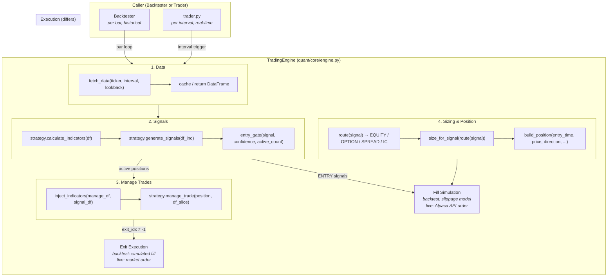

# quant/core — Trading Engine

Centralized decision logic shared by **backtest** (`quant/src/quant/backtest/`) and **live** (`python/trader.py`).

## Why

Before `quant/core`, the same decisions (entry gating, signal routing, sizing, indicator injection, position schema) were implemented **independently** in the backtester classes and in `trader.py`. Any change had to be mirrored in both places — and they inevitably diverged.

`TradingEngine` is the single class that owns all trading *decisions*. Callers own *execution* (simulated fills vs. Alpaca API orders). The only difference between backtest and live is **when** each pipeline step runs:

| | Backtest | Live |
|---|---|---|
| **Data** | Full history fetched once | Rolling window refreshed each cycle |
| **Signals** | Computed once over full window | Computed each interval |
| **Manage** | Called per-bar in the signal loop | Called each cycle for open positions |
| **Execution** | Slippage model, simulated fills | Alpaca market/limit orders |

## Pipeline



## One tick, end to end (`process_strategy`)

The caller above the pipeline is a single method — `process_strategy(strategy, now, executor)` — shared verbatim by backtest and live. The `executor` argument (`ExecutorProtocol`) is the only environment difference: `should_run`, `data_end_dt`, `get_precomputed_signal`, `active_positions`, `enter`, `exit`, `after_*`, `record_run`. This is the parity guarantee: any behavior that must match in backtest and live lives here; anything environment-specific lives in the executor.

```
TICK.SHOULD_RUN ──no──> record_run + return      (schedule de-dup: skips still consume the bar)
   │ yes
   ▼
FETCH.DATA (lookback: DAILY_START walk-forward | PRE_LOAD_DAYS rolling)
   ──attach_raw_close──> fetch_manage_data (indicator injection reuses signal df)
   ▼
process_ticker:  MANAGE.EVALUATE (exits before entries — no same-bar re-entry)
   │             then ENTRY.GATE (skip_signals for manage-only cycles)
   ▼
DISPATCH ──EXIT──> executor.exit(s_name, pos, sig, manage_df) ──> after_exit
         ──ENTRY──> executor.enter(strategy, ticker, row, engine) ──> after_entry
   │
   ▼
monitor.emit (async queue — never blocks)
```

Live entry routing then splits by asset class via `engine.route(signal)`:

| Asset class | Live executor path |
|---|---|
| IC | `IronCondorExecutor.enter/exit` — 4-leg MLEG combo, adaptive fill loops |
| OPTION | `UnifiedExecutor._enter_option_trade` — expiry lookup → strike search → single order |
| SPREAD | routed but **not yet implemented** (futures-spread hook) |
| EQUITY / CRYPTO | `UnifiedExecutor._enter_linear_trade` — market/limit on symbol |
| FUTURES | registered asset class (margin sizing) — linear single-leg via the same path, no signals yet |

## Asset Classes

All asset classes flow through the same pipeline. `route(signal)` maps the signal string through the `SIGNAL_REGISTRY` (equity/option/spread/IC today; `FUTURES` / `OOF` are registered asset classes with no signals yet):

| Signal | Asset Class | Sizing | Fill Model |
|---|---|---|---|
| `BUY`, `SELL`, `LONG`, `SHORT` | EQUITY | `size_for_signal` → EquitySizing (fraction of equity) | Slippage $/share or % factor |
| `BUY_CALL`, `BUY_PUT`, … | OPTION | `size_for_signal` → OptionSizing (premium-based) | Volume-impact fill |
| `BUY_SPREAD`, `SELL_SPREAD` | SPREAD | `size_for_signal` → SpreadSizing (fixed dollar) | Synthetic bid/ask + fixed $0.05 slippage |
| `SELL_IC`, `BUY_IC` | IC | `size_for_signal` → IronCondorSizing (collateral-based) | Combo slippage + residual extrinsic + commission |
| — (no signals yet) | FUTURES | `size_for_signal` → FuturesSizing (per-contract margin) | Linear single-leg via the unified path |

## Key Methods

### Data (Step 1)
Module-level in `quant.core._utils` — `process_strategy` calls them through
`self.data_handler`, they are **not** engine methods anymore (the engine
pass-through shims were removed):
- **`fetch_data(data_handler, ticker, end_dt, lookback, interval, adjustment="all")`** — bars via `DataHandlerProtocol.get_historical_data`; trims an incomplete trailing daily bar (adjusted-bar invariant)
- **`fetch_manage_data(data_handler, config, ticker, end_dt, lookback, interval, signal_df=None)`** — manage-resolution bars; reuses the signal frame when provided

### Signals (Step 2)
- **`run_signals(df, ticker=None)`** (engine) — `calculate_indicators` → `generate_signals` → cache; spans via `Span`/`SpanName`
- **`latest_signal(df_sig)`** (engine) — extract `(signal, confidence, row_dict)` from last bar
- **`should_enter(signal, confidence, active_count)`** (engine) — entry gate (returns `None` or rejection reason; `check_entry_gate` in `_utils`)
- **`warmup(now)`** (engine) — best-effort pre-open cache warm (called off the decision path; tracked as the non-SLO `warmup_total_ns` span)

### Manage (Step 3)
- **`cache_signals(ticker, signal_df)`** (engine) — store signal df for later indicator injection
- **`inject_indicators(manage_df, signal_df, config)`** (`_utils`) — merge_asof indicator injection
- **`call_manage_trade(strategy, position, manage_df, signal_df=None, config=None)`** (`_utils`) — inject indicators + run `manage_trade`; returns `exit_idx` (-1 = hold)

### Sizing & Position (Step 4)
- **`route(signal)`** (engine) → `"EQUITY"` / `"OPTION"` / `"SPREAD"` / `"IC"` (via `SIGNAL_REGISTRY`; `FUTURES`/`OOF` additive)
- **`direction(signal)`** (engine) → `+1` or `-1`
- **`size_for_signal(signal, *, config, **kw)`** — `quant.core.sizing` registry dispatch by asset class; **live executors call it directly** (the old `engine.size_for_signal` shim is gone)
- **`build_position(entry_time, entry_price, direction, signal, confidence, **extra)`** (engine)
- **`build_ic_position(entry_time, underlying_price, ic_direction, signal, confidence, strikes, **extra)`** (engine)

### Helpers (`quant.core._utils` unless noted)
- **`select_strike(underlying_price, opt_type, config)`** — ATM/ITM/OTM strike selection (live option executor)
- **`calc_spread_width(underlying_price, config)`** — adaptive or config-based spread width
- **`apply_slippage(raw_price, direction, is_entry)`** — fixed-$ or %-based slippage (`quant.backtest.utils`, backtest-only)

### Unified Loop
- **`process_ticker(df, manage_df, ticker, active_positions, *, df_sig=None, skip_signals=False)`** (engine) — full per-ticker pipeline: manage exits → signals → entry gate. Returns a list of `EXIT`/`ENTRY` dicts. This is the same method called by both `trader.py` (once per cycle) and the backtester (per bar).

## Usage

### Live (trader.py)
```python
from quant.core.engine import TradingEngine

# Constructor is (strategy, data_handler) — config comes from strategy.config;
# monitor_emit is the optional live hook (trader wires python.monitor.emit).
engine = TradingEngine(strategy, data_handler, monitor_emit=monitor_emit)

# One full tick: schedule → fetch/manage data → manage exits → entry gate →
# dispatch EXIT/ENTRY through the executor (LiveExecutor wraps UnifiedExecutor).
engine.process_strategy(strategy, now, executor)
```

### Backtest
```python
from quant.core.engine import TradingEngine

engine = TradingEngine(strategy, backtest_data_handler)

# Pre-compute signals once over full history
df_sig = engine.run_signals(df, ticker=ticker)

# Bar loop (no lookahead — engine sees only data up to current bar); the
# backtest executor serves each bar as `get_precomputed_signal`, so
# process_ticker skips run_signals per bar (df_sig=... is the bypass).
for ts, row in df_sig.iterrows():
    bar_manage = manage_df[manage_df.index <= ts]
    bar_sig = df_sig.loc[[ts]]
    actions = engine.process_ticker(df, bar_manage, ticker, active, df_sig=bar_sig)
    # ... handle fills with the slippage model
```

## Standalone Functions

These live in `quant.core._utils` (engine re-exports nothing — import them
directly from their owning module):

```python
from quant.core._utils import (
    ALL_ENTRY_SIGNALS,
    signal_asset_class,
    signal_direction,
    select_strike,
    calc_spread_width,
    inject_indicators,
    check_entry_gate,
    build_position_dict,
    fetch_data,
    fetch_manage_data,
    call_manage_trade,
    closed_bar_asof,
    bar_close_utc,
)
from quant.core.sizing import size_for_signal, size_for_asset
from quant.core.monitor_utils import Span, SpanName, span_key, SLO_SPAN_KEYS
```
